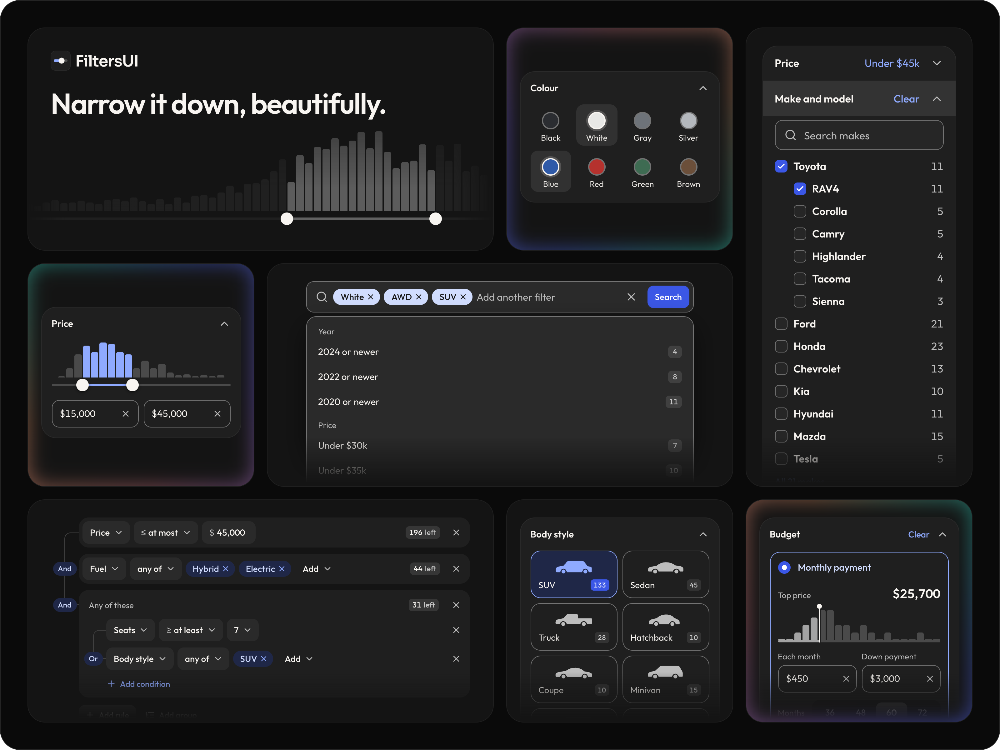
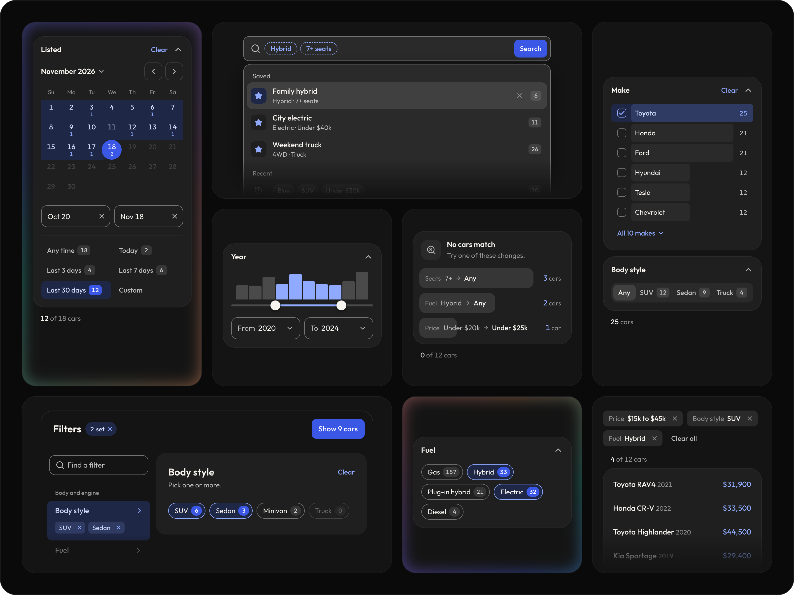
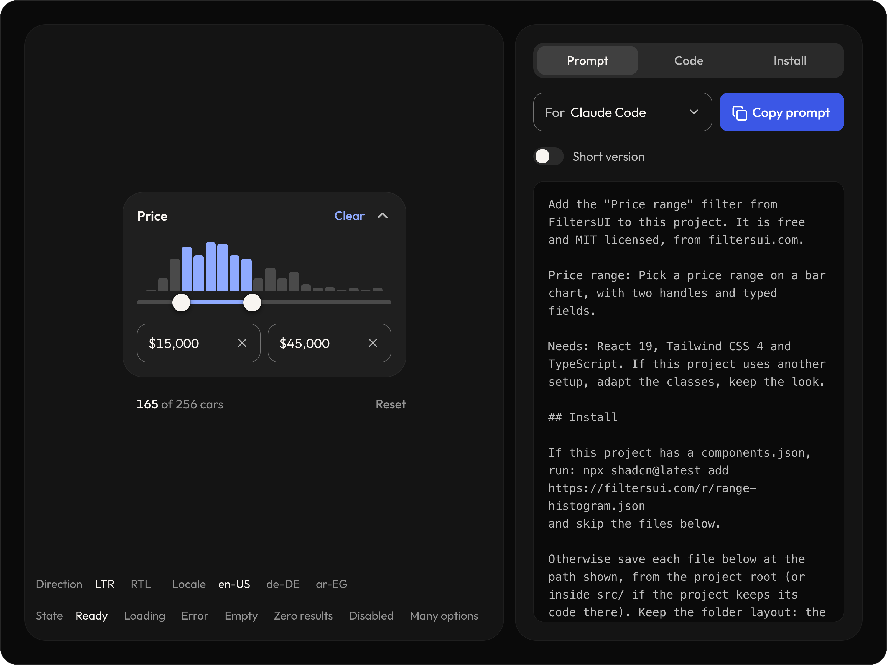
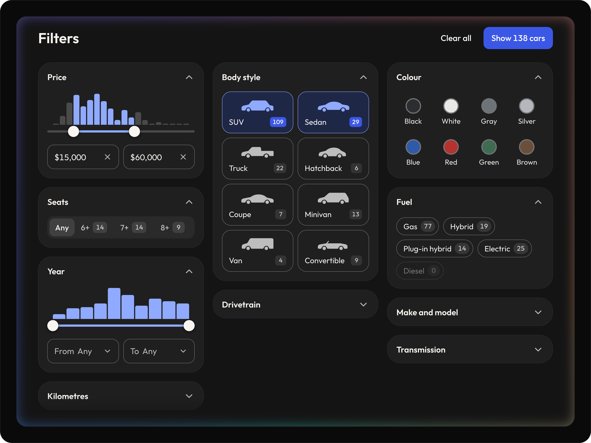

# FiltersUI

Free filter cards for search pages. Play with one live, then copy the code or a ready prompt for Claude Code, Cursor, v0 or Lovable.

**[filtersui.com](https://filtersui.com)**

<a href="https://filtersui.com">
  <picture>
    <source media="(prefers-color-scheme: light)" srcset=".github/readme/cover-light.png">
    
  </picture>
</a>

## What's inside

24 components, free and MIT licensed:

- **19 filters**: price range, year range, upper limit, chips, colour swatches, icon tiles, segmented choice, searchable list, bar list, cascading dropdown, date range, budget, sentence search, recent searches, rules, filter pills, applied filters, no results and all filters.
- **3 basics**: dropdown, select, buttons and links.
- **2 full sets**: every filter on one board, and a filter panel.

Most come with loading, error, empty and disabled states. All of them work with a keyboard and a screen reader, lay out right to left, and print numbers and dates in your locale. Dark by default, with a light theme.

<a href="https://filtersui.com/#filters">
  <picture>
    <source media="(prefers-color-scheme: light)" srcset=".github/readme/more-light.png">
    
  </picture>
</a>

## Use one

Open a filter on [filtersui.com](https://filtersui.com) and try it. Then take it one of three ways:

1. **Prompt**: copy a ready prompt for Claude Code, Cursor, v0 or Lovable.
2. **Code**: copy the files from the Code tab.
3. **Install** with the shadcn CLI:

   ```bash
   npx shadcn@latest add https://filtersui.com/r/range-histogram.json
   ```

Needs React 19, Tailwind CSS 4 and TypeScript.

<a href="https://filtersui.com/filters/range-histogram">
  <picture>
    <source media="(prefers-color-scheme: light)" srcset=".github/readme/copy-light.png">
    
  </picture>
</a>

## The full set

All the filters on one board, with Clear all and a Show button.

<a href="https://filtersui.com/sets/cars">
  <picture>
    <source media="(prefers-color-scheme: light)" srcset=".github/readme/set-light.png">
    
  </picture>
</a>

## Global styles in your project

The filters style themselves with Tailwind utilities, which live in `@layer utilities`. CSS outside any layer wins over every layer, so a global reset such as `button { padding: 8px 16px; background: #eee }` repaints the filters. Put resets like that in `@layer base`.

## Run the site

```bash
npm install
npm run dev
```

## Licence

MIT. Use it in anything, paid work included.

Designed and built by [Eugen Eşanu](https://eugenesanu.com).
